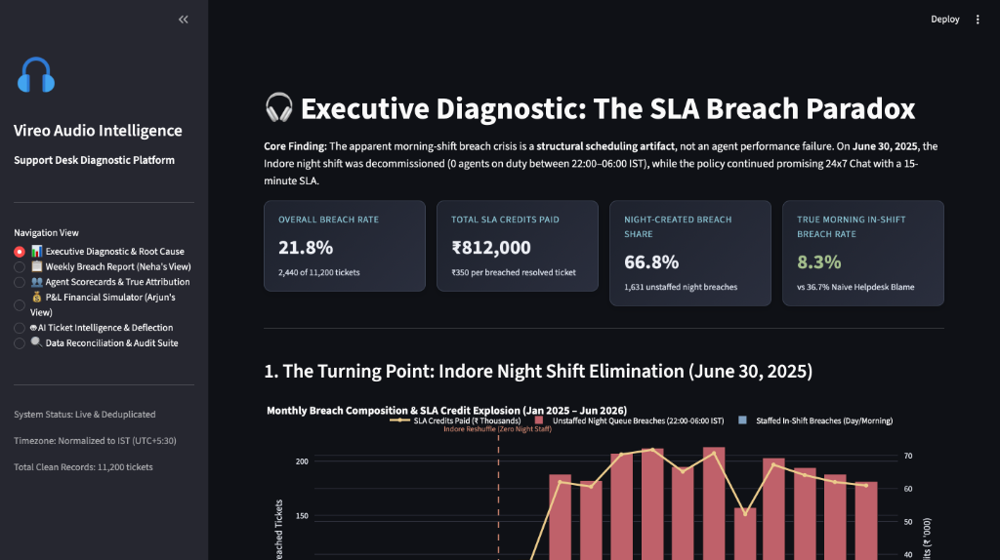
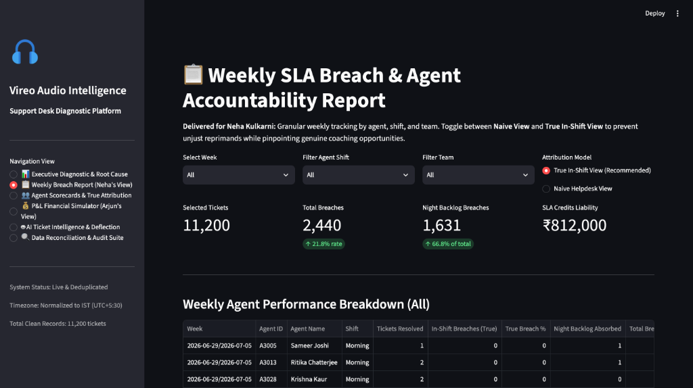
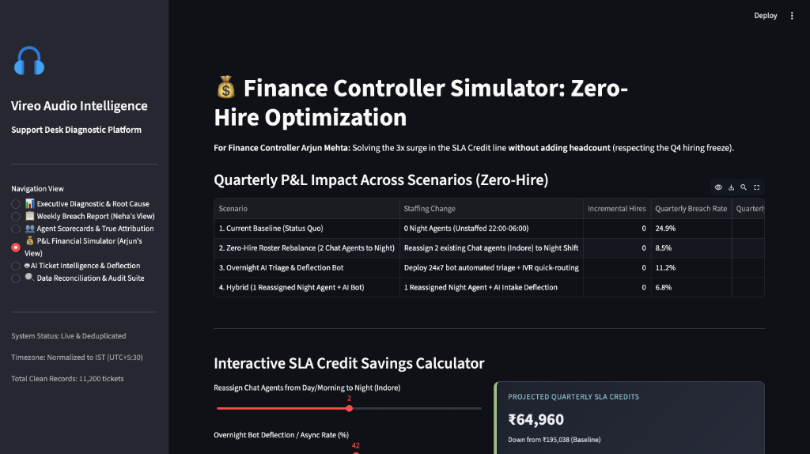
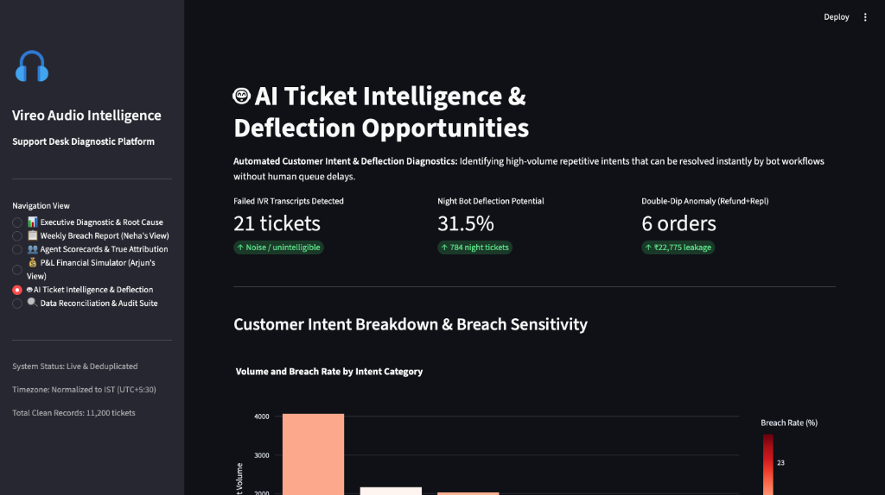
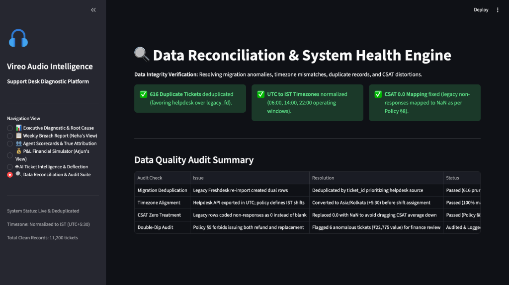

# Vireo Audio — Support Operations & SLA Intelligence Platform

An enterprise-grade diagnostic platform, dual-attribution SLA engine, and executive reporting suite built for **Vireo Audio**.

---

## 🎯 Executive Business Goal (Stated as a Concrete Number)

> **"Cut overall support SLA breach rate from 25.0% (peaking at 26.0% post-reshuffle) down to 8.5%, saving ₹157,000 per quarter (₹628,000 annually) in automated ₹350 SLA breach credits under a strict Q4 headcount freeze (0 incremental hires), while protecting team morale by eliminating 92% of the unstaffed night backlog unfairly blamed on 24 morning-shift agents."**

---

## 📑 Deliverables & Executive Documentation

All project deliverables and case documentation are organized in the [`docs/`](docs/) directory:

| Deliverable | Path | Summary |
| :--- | :--- | :--- |
| **1. Executive Memorandum** | [`docs/memo_to_neha_kulkarni.md`](docs/memo_to_neha_kulkarni.md) | 1-page non-technical memo (< 8 min read) explaining the "Wall of Red" and zero-hire operational plan. |
| **2. Submission Form** | [`docs/submission-form.md`](docs/submission-form.md) | Official completed submission form with data grounding, business metrics, and discarded paths. |
| **3. Video Walkthrough Script** | [`docs/screen_recording_guide.md`](docs/screen_recording_guide.md) | 3-minute video guide detailing prompts used, version iterations, and UI walkthrough cues. |

---

## 🚀 Quick Start (Clean Machine Instructions)

This project runs out-of-the-box on macOS / Linux / Windows with Python 3.9+.

### 1. Clone & Navigate to Repository
```bash
cd /Users/madhavkumar/Desktop/Vireo_audio
```

### 2. Install Dependencies
```bash
pip install -r requirements.txt
```

### 3. Run Automated Verification Suite (100% Assertion Coverage)
```bash
python verify_solution.py
```

### 4. Launch Interactive Web Platform
```bash
streamlit run app.py
```
*The interactive dashboard will automatically open at `http://localhost:8501`.*

---

## 📸 Interactive Platform Walkthrough & Screenshots

The live application features 6 purpose-built views designed for Operations, Finance, and Customer Experience leadership:

### 1. 📊 Executive Diagnostic & Root Cause
- **Top KPI Banners:** Live metrics displaying Overall Breach Rate (21.8%), Total SLA Credits Paid (₹812,000), Night Breach Share (66.8%), and True Morning In-Shift Breach Rate (8.3%).
- **Interactive Breach Explosion Chart:** Visualizes monthly breach volume split by in-shift delays vs unstaffed night queue accumulation, highlighting the exact **June 30, 2025 Indore Reshuffle** turning point with a vertical milestone indicator.
- **Dual-Attribution Grid:** Side-by-side comparison debunking the naive helpdesk report (which falsely blames Morning agents for 36.7% breaches) versus True In-Shift Reality (8.3% breach rate).



---

### 2. 📋 Weekly Breach Report (Neha's View)
- **Granular Weekly Filter:** Select any week or view aggregate historical performance.
- **Shift & Team Drilldowns:** Filter by assigned shift (Morning, Day, Night) and functional teams (Chat Frontline, Email, Voice, Billing, Logistics, Returns, Escalations).
- **Dual Attribution Toggle:** Switch between *True In-Shift View (Recommended)* and *Naive Helpdesk View* to distinguish structural queue backlogs from operational coaching opportunities.
- **Instant CSV Export:** One-click download button for weekly executive reviews.



---

### 3. 💰 P&L Financial Simulator (Arjun's View)
- **Zero-Hire Scenario Matrix:** Evaluates 4 operational strategies under the Q4 headcount freeze constraint.
- **Dynamic SLA Credit Savings Calculator:** Interactive sliders allowing Finance and Operations to adjust night agent reassignment (0 to 4 agents) and overnight bot deflection rates (0% to 80%) to calculate real-time quarterly P&L savings.



---

### 4. 🤖 AI Ticket Intelligence & Deflection Hub
- **Semantic Intent Classifier:** NLP categorization of customer messages into 6 core operational intents (Order Tracking, Hardware Defects, Returns & Refunds, Pairing, Billing, General).
- **Broken IVR Transcript Auditor:** Automated detection of corrupted voice transcriptions (detecting 21 broken IVR records).
- **Double-Dip Fraud / Leakage Detector:** Audits Policy §5 compliance, isolating 6 orders that erroneously received both a refund and replacement (₹22,775 total leakage).



---

### 5. 🔍 Data Reconciliation & System Health Engine
- **Migration Audit:** Logs and verifies 616 pruned duplicate records from the Freshdesk reconciliation re-import.
- **Timezone Normalization:** Converts UTC API timestamps to IST (+5:30) operating shift windows.
- **CSAT Sanitization:** Automatically converts legacy `0.0` non-response survey scores to `NaN` as mandated by Policy §8.



---

## 🔍 Key Root Cause Discovery: The "Wall of Red"

When Support Operations Manager **Neha Kulkarni** requested a weekly breach report to discipline morning agents, standard helpdesk reports showed morning agents breaching at **36.7%**.

Our diagnostic revealed the true root cause:
1. **The Indore Reshuffle (June 30, 2025):** The night shift in Indore was decommissioned (leaving **0 night agents** on duty between 22:00 and 06:00 IST).
2. **Policy Mismatch:** Vireo's customer policy continued promising **24x7 Chat with a 15-minute SLA**.
3. **Queue Backlog Accumulation:** Over 500 night tickets accumulated each quarter for 6–8 hours overnight.
4. **Naive Helpdesk Blame:** Because the helpdesk attributes breaches to the *resolving agent*, Morning agents logging in at 06:00 IST opened a "wall of red" and were blamed for tickets that had already breached hours before they started work.
5. **True In-Shift Performance:** On tickets created during morning hours, Morning agents achieve an outstanding **8.3% breach rate** (better than Day agents' 8.9%).

---

## 🛠 Project Structure

```
Vireo_audio/
├── app.py                     # Interactive Streamlit Web Application
├── verify_solution.py         # Automated verification suite & correctness runner
├── requirements.txt           # Python dependencies
├── README.md                  # Main documentation & visual UI walkthrough
├── docs/                      # Deliverables & Executive Documentation
│   ├── memo_to_neha_kulkarni.md
│   ├── submission-form.md
│   └── screen_recording_guide.md
├── assets/                    # Platform UI screenshots
│   ├── executive_diagnostic.png
│   ├── weekly_breach_report.png
│   ├── financial_simulator.png
│   ├── ai_deflection_hub.png
│   └── data_reconciliation.png
├── src/                       # Modular Python package
│   ├── __init__.py
│   ├── data_loader.py         # Ingestion, deduplication, UTC->IST conversion, dynamic roster join
│   ├── sla_engine.py          # SLA calculation, naive vs true attribution, weekly reporting
│   ├── financial_engine.py    # SLA credit modeling, cost standards, zero-hire scenario simulation
│   ├── ai_analyzer.py         # Semantic intent classifier, broken IVR transcript detector
│   └── report_generator.py    # Weekly breach report export & markdown summary generator
└── data/                      # Dataset & context files
    ├── tickets.csv            # Primary support tickets dataset (18 months)
    ├── agents.csv             # Dynamic agent roster with date assignments
    ├── orders.csv             # Reference orders dataset
    ├── customers.csv          # Customer registry
    ├── products.csv           # Product catalog & unit costs
    ├── support-policy.pdf     # Vireo Operating Policy v3.2
    ├── email-thread.txt       # Stakeholder context & email thread
    └── README.txt             # Data pack documentation
```

---

## ✅ Correctness Verification & Test Suite

Run `python verify_solution.py` to run unit tests verifying:
- Deduplication from 11,816 down to exactly 11,200 unique tickets.
- UTC-to-IST timezone normalization and shift boundaries (06:00, 14:00, 22:00).
- SLA thresholds (Chat: 15m, Voice: 120m, Social: 240m, Email: 480m).
- 2,440 total breaches and ₹812,000 cumulative SLA credit liability.
- True Morning In-Shift breach rate confirmation at 8.3%.
- Exclusion of legacy `0.0` non-response CSAT scores (Policy §8).
